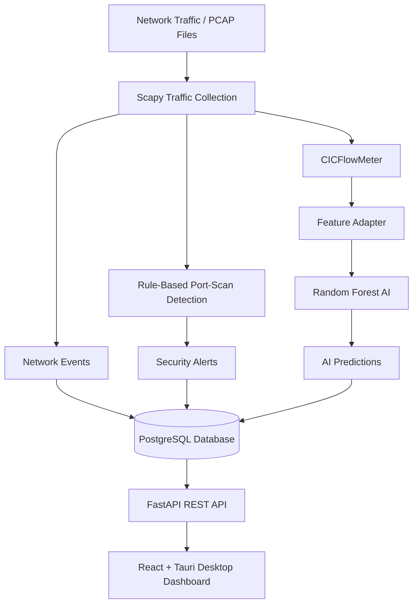

# TegROA — Intelligent Network Threat Detection and Security Monitoring System

## Project Overview

TegROA is a network security monitoring project developed for an Advanced Network Security course. It combines packet capture, network event storage, rule-based port-scan detection, machine-learning inference, and a desktop monitoring dashboard.

## System Architecture

## Project Structure

- `backend/app/` — FastAPI application and security monitoring modules
- `backend/app/database/` — Database connection and SQLAlchemy models
- `backend/app/traffic/` — Live packet capture and PCAP import
- `backend/app/detection/` — Port-scan detection logic
- `backend/app/ml/` — Machine-learning inference and flow processing
- `backend/deployment/` — Linux systemd service definitions
- `backend/tests/` — Backend test cases
- `desktop/src/` — React desktop dashboard
- `desktop/src-tauri/` — Tauri desktop application
- `docs/` — Project design documentation
- `evidence/` — Testing evidence and screenshots
- `lab/` — Network security laboratory materials

## Technologies

Python, FastAPI, PostgreSQL, SQLAlchemy, Scapy, CICFlowMeter, scikit-learn, React, Tauri, Rust, and Linux systemd.

## Implemented Features

- Import TCP and UDP network events from PCAP files
- Capture live network traffic
- Store network events in PostgreSQL
- Detect suspicious TCP port-scanning behavior
- Store and display security alerts
- Perform Random Forest inference on network flow features
- Store and display AI flow predictions
- View monitoring statistics in a desktop dashboard
- Run live monitoring components using Linux systemd services

## Security and Privacy

Database credentials are provided through environment variables. Local environment files, virtual environments, runtime captures, and generated build artifacts are excluded from the public repository.

## Known Limitations

- Machine-learning performance on a held-out dataset does not establish equivalent accuracy on real-world traffic.
- Live AI-based detection of malicious port-scan flows requires further validation.
- CICFlowMeter compatibility adjustments in the development environment require documentation for reproducible installation.
- Desktop Start/Stop controls require additional integration testing across monitoring services.
- The repository does not include the original large datasets or packet captures.

## Project Status

Academic prototype under active development. The repository documents the implemented system, architecture, and source-code structure.
