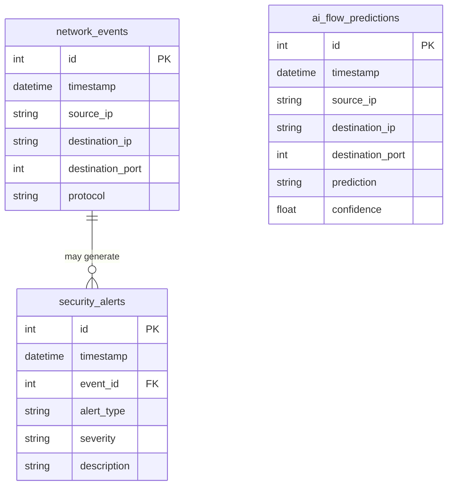

# TegROA — Database Design

## Overview

TegROA uses PostgreSQL with SQLAlchemy ORM models to store network events, security alerts, and AI flow predictions.

## 1. network_events

Stores captured or imported network traffic metadata.

| Column | Type | Description |
|---|---|---|
| id | INTEGER | Primary key |
| timestamp | TIMESTAMP WITH TIME ZONE | Event creation time, UTC default |
| source_ip | VARCHAR(45) | Source IP address |
| destination_ip | VARCHAR(45) | Destination IP address |
| destination_port | INTEGER | Destination port |
| protocol | VARCHAR(20) | Network protocol |

## 2. security_alerts

Stores alerts generated by security detection logic.

| Column | Type | Description |
|---|---|---|
| id | INTEGER | Primary key |
| timestamp | TIMESTAMP WITH TIME ZONE | Alert creation time, UTC default |
| event_id | INTEGER, nullable | Foreign key to network_events.id |
| alert_type | VARCHAR(100) | Detection category |
| severity | VARCHAR(20) | Alert severity |
| description | VARCHAR(500) | Alert explanation |

## 3. ai_flow_predictions

Stores AI classification results for network flows.

| Column | Type | Description |
|---|---|---|
| id | INTEGER | Primary key |
| timestamp | TIMESTAMP WITH TIME ZONE | Prediction creation time, UTC default |
| source_ip | VARCHAR(45) | Source IP address |
| destination_ip | VARCHAR(45) | Destination IP address |
| destination_port | INTEGER | Destination port |
| prediction | VARCHAR(30) | Predicted traffic class |
| confidence | FLOAT | Model confidence score |

## Relationships

- One network event may be referenced by multiple security alerts.
- Each security alert may optionally reference one network event.
- AI flow predictions have no explicit foreign-key relationship to the other two tables.

## Entity Relationship Diagram

## Implementation Notes

The schema is defined in backend/app/database/models.py and backend/app/ml/models.py.

The FastAPI application calls SQLAlchemy metadata.create_all during startup. This creates missing tables but is not a database migration system.

Database credentials must be provided through the local environment configuration and must not be committed to the public repository.
